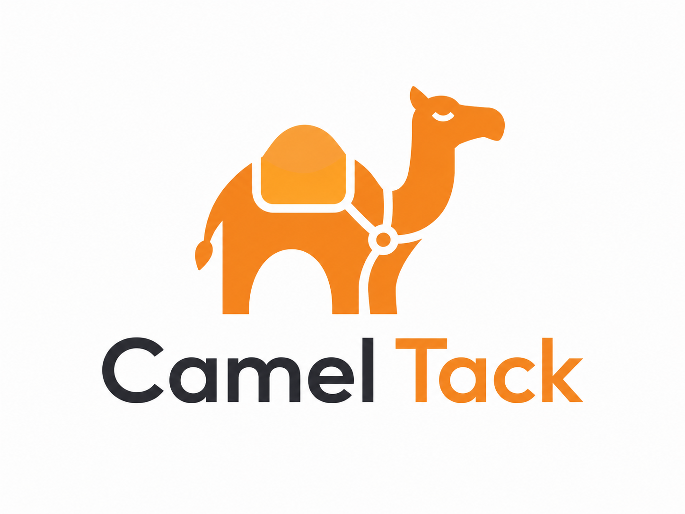

# Camel Tack



Camel Tack is a Camel-native runtime for mission-bound LLM agents.

Application authors express agent behavior as ordinary Camel routes. Tack adds a small producer component for agent primitives, a catalog for personas and routines, Kafka-backed inference lanes, optional MCP tools, and observable mission and AgentRun state.

The public authoring contract is the `tack:` component. The runtime underneath it is intentionally built from Camel routes and Camel components. Kafka routes provide durable scheduling, bounded model concurrency, partition-key ordering, request/reply correlation, and worker isolation. Those routes are framework-owned runtime infrastructure, not routes that application authors are expected to call or customize casually.

> **Project status:** Tack is an evolving local/runtime prototype. Agent state and LLM reply waiters are currently in memory, and synchronous request/reply assumes one active orchestrator process. See [Current boundaries](#current-boundaries).

## Why Tack

Agent systems often hide orchestration inside imperative services, executor pools, and long-lived agent objects. Tack keeps orchestration in Camel, where control flow, asynchronous boundaries, error handling, transport, and observability remain explicit.

Tack is designed around four ideas:

- **Routes are the workflow language.** A routine is a Camel route, not an opaque agent loop.
- **The component is the authoring boundary.** Routine authors invoke semantic operations such as `tack:act`, `tack:decide`, and `tack:create`.
- **Kafka is the model concurrency boundary.** Inference lanes queue work and enforce the configured number of active model calls.
- **Agent state is runtime state.** Missions, AgentRuns, thoughts, decisions, created values, and projection history are stored independently from any one LangChain4j invocation.

## Architecture

Tack has two deliberately different surfaces:

### Application surface

Application code owns:

- personas;
- routines and subroutines;
- prompts and JSON schemas;
- inference-lane declarations;
- MCP server declarations and tool profiles;
- domain-specific route logic.

A routine looks like normal Camel DSL:

```java
from("direct:my-domain-coordinator")
        .setHeader(TackHeaders.THOUGHT_PURPOSE, constant("""
                Mission plan, known evidence, blockers, and next move.
                """))
        .to("tack:thought-enter?name=coordinator&maxTokens=1200")
        .setHeader(TackHeaders.PROMPT, constant("""
                Inspect the available project evidence and identify the next useful action.
                """))
        .to("tack:act?id=review-workspace&toolProfile=workspace-readonly")
        .setHeader(TackHeaders.PROMPT, constant("""
                Is this routine complete for the current pass?
                """))
        .to("tack:decide?id=done")
        .to("tack:thought-exit?name=coordinator");
```

### Runtime surface

Tack owns the execution machinery needed to fulfill those operations:

- mission admission routes;
- AgentRun scheduling and execution routes;
- Kafka request and reply routes for every inference lane;
- model-worker routes;
- LLM request/reply correlation;
- primitive execution and thought management;
- MCP client construction and tool-result limiting;
- workspace projection updates.

These routes exist in the application `CamelContext`, so they remain inspectable with normal Camel tooling. They should be understood as **synthetic runtime routes owned by Tack**, not as application workflow routes authored by the adopter.

### End-to-end flow

```text
POST /missions
  -> admit Mission and AgentRuns
  -> publish AgentRunScheduled to Kafka

AgentRunScheduled consumer
  -> transition accepted AgentRun to running
  -> launch its routine asynchronously

application routine route
  -> tack:thought-enter
  -> tack:act / tack:decide / tack:create
  -> tack:thought-exit

Tack primitive
  -> prepare an LLM job
  -> direct:llm
  -> publish to the selected lane request topic

lane worker route
  -> invoke the configured model and optional MCP tools
  -> publish LlmJobResult to the lane reply topic

reply consumer
  -> correlate by jobId
  -> resume the waiting primitive
  -> update AgentRun state and projection history
```

### What the component owns—and what it does not

The `tack:` component is producer-only. It validates endpoint parameters and required Tack headers, then delegates the requested primitive to the shared Tack runtime.

Creating a `tack:` endpoint does **not** create a private Kafka consumer or a new worker pool. All Tack endpoints in one application share the runtime routes and inference lanes registered in that `CamelContext`.

The current implementation delegates primitive choreography to `PrimitiveExecutor`, which submits model work through the internal `direct:llm` route. That is an implementation boundary, not a promise that primitive orchestration must remain imperative. The public `tack:` endpoint contract can remain stable while internal choreography evolves between processors, beans, route templates, or explicit internal routes.

## Core model

### Mission

A `Mission` is the top-level goal and context container. It owns the mission ID, goal, status, metadata, and the AgentRuns admitted for that mission.

### AgentRun

An `AgentRun` is one execution of one persona on one routine or declared subroutine.

It carries:

- persona, routine, and optional subroutine identity;
- structured input and working state;
- primitive state and latest results;
- thought-stack state;
- lifecycle status and timestamps;
- projection and timeline data;
- parent lineage when another AgentRun scheduled it.

Parent/child lineage does not imply synchronous waiting. Scheduling a child AgentRun returns an accepted handle; the parent continues unless its own routine chooses to observe later state.

### Persona

A `Persona` defines the actor presented to the model: name, description, behavioral traits, display metadata, and external identity mappings. A persona does not directly own tools.

### Routine

A `RoutineDefinition` maps a catalog ID to a Camel route URI. It may declare one main route and named public subroutines. A routine also selects a default inference lane.

### ToolProfile

A `ToolProfile` defines which MCP servers and tools are available during an act. Profiles can:

- attach concrete MCP server definitions;
- allow or deny tools;
- add default tool arguments;
- provide prompt guidance;
- cap tool-result tokens.

When `tack:act` omits a profile, Tack uses the built-in no-tools profile.

### InferenceLane

An `InferenceLaneDefinition` is a Kafka-backed model work pool. It declares:

- request and reply topics;
- model endpoint, model name, and API-key resolution;
- worker parallelism;
- Kafka partition-key strategy.

Lanes are shared runtime resources. They are not created per routine or per endpoint.

### Thought stack

Each AgentRun owns a stack of scoped `ThoughtFrame` values. A thought has a name, purpose, token budget, content, identity, and timestamps.

- `thought-enter` pushes a child scope.
- `act` rewrites the active leaf from newly observed evidence.
- `thought-exit` consolidates a populated child into its parent before popping it.
- projection history preserves prior rewrites and exits even after a child leaves the active stack.

## Quick start

### Requirements

- Java 21
- Maven
- Kafka
- an OpenAI-compatible chat-completions endpoint, such as vLLM
- optional MCP servers when tool-enabled profiles are used

The project currently uses Quarkus `3.36.0`, LangChain4j `1.16.3`, and a narrow Camel LangChain4j Agent snapshot dependency for endpoint-level agent configuration and JSON-schema support.

### Configure a local runtime

```bash
export KAFKA_BOOTSTRAP_SERVERS=localhost:9092

export LLM_MODEL_DEFAULT_OPENAI_BASE_URL=http://localhost:8000/v1
export LLM_MODEL_DEFAULT_OPENAI_MODEL=qwen-36-27b
export LLM_MODEL_DEFAULT_OPENAI_API_KEY=not-needed

export LLM_WORKER_ENABLED=true
export LLM_LOCAL_WORKER_ROUTE_VERIFICATION_ENABLED=true
export LLM_KAFKA_PROVISION_TOPICS=true
```

Start Quarkus:

```bash
./mvnw quarkus:dev
```

Submit a mission:

```bash
curl -s -X POST http://localhost:8080/missions \
  -H 'content-type: application/json' \
  --data '{
    "goal": "Build a small parking lot manager app. Clarify scope, coordinate the work, and begin one implementation path.",
    "agentRuns": [
      {
        "personaId": "software-team/noah",
        "routineId": "software-team/director"
      }
    ]
  }' | jq
```

The API returns `202 Accepted` after admission and scheduled-event publication:

```json
{
  "missionId": "mission-...",
  "status": "accepted",
  "agentRuns": [
    {
      "agentRunId": "run-...",
      "missionId": "mission-...",
      "parentAgentRunId": null,
      "personaId": "software-team/noah",
      "routineId": "software-team/director",
      "status": "accepted"
    }
  ]
}
```

Inspect runtime state:

```bash
curl -s http://localhost:8080/workspace/view | jq
```

Reset in-memory workspace state between experiments:

```bash
curl -s -X POST http://localhost:8080/workspace/reset | jq
```

## Writing a Tack application

Catalog entries are discovered from CDI beans.

| Provider | Registers |
| --- | --- |
| `PersonaProvider` | Personas |
| `RoutineProvider` | Routine definitions and route URIs |
| `ToolProfileProvider` | MCP capability profiles |
| `InferenceLaneProvider` | Kafka/model inference lanes |

At minimum, an adopter supplies personas, routines, inference lanes, and the `AgentRunRequest` values submitted to a mission.

### Define a persona

```java
@ApplicationScoped
public class CoordinatorPersona implements PersonaProvider {
    public static final String ID = "my-domain/coordinator";

    @Override
    public List<Persona> personas() {
        return List.of(Persona.builder(ID)
                .name("Coordinator")
                .description("Coordinates mission work and starts useful AgentRuns.")
                .trait("Keeps plans concrete and reports blockers clearly.")
                .label("COORD")
                .color("38;2;100;180;255")
                .build());
    }
}
```

External tool identities can be attached with `identity(...)`. Use `agentRunStartAssignable(false)` when orchestration prompts should not propose that persona for new runs.

### Define a routine

```java
@ApplicationScoped
public class CoordinatorRoutine extends RouteBuilder implements RoutineProvider {
    public static final String ID = "my-domain/coordinator-routine";

    @Override
    public List<RoutineDefinition> routines() {
        return List.of(RoutineDefinition.builder(ID)
                .name("Coordinator Routine")
                .main(
                        "Gather context, choose the next work, coordinate it, and close out.",
                        "direct:my-domain-coordinator")
                .subroutine(
                        "bootstrap",
                        "Perform only initial collaboration setup.",
                        "direct:my-domain-coordinator-bootstrap")
                .defaultLane("low-pass")
                .build());
    }

    @Override
    public void configure() {
        from("direct:my-domain-coordinator")
                .setHeader(TackHeaders.THOUGHT_PURPOSE, constant("""
                        Mission plan, evidence, blockers, and next coordination move.
                        """))
                .to("tack:thought-enter?name=coordinator&maxTokens=1000")
                .setHeader(TackHeaders.PROMPT, constant("""
                        Inspect current workspace state and identify the next useful move.
                        """))
                .to("tack:act?id=workspace-review&toolProfile=workspace-readonly")
                .to("tack:thought-exit?name=coordinator");
    }
}
```

The route URI is an application-owned entry point. Tack resolves it when an AgentRun starts and restores mission, persona, routine, subroutine, and AgentRun state onto the exchange.

### Define an inference lane

```java
@ApplicationScoped
public class LowLane implements InferenceLaneProvider {
    @Override
    public InferenceLaneDefinition inferenceLane() {
        return InferenceLaneDefinition.builder("low-pass")
                .requestTopic("llm.requests.low")
                .responseTopic("llm.replies.low")
                .parallelism(1)
                .partitionKeyStrategy(PartitionKeyStrategy.AGENT_RUN)
                .endpoint("http://localhost:8000/v1")
                .model("qwen-low")
                .apiKeyConfigKey("llm.inference-lane.low.api-key")
                .apiKeyEnvVariable("LLM_LOW_API_KEY")
                .build();
    }
}
```

Lane-specific endpoint, model, and API-key values override the global model defaults.

### Define an MCP server and tool profile

```java
@ApplicationScoped
public class RepositoryMcpServer {
    public static final String ID = "repository";

    private final McpServerDefinition definition;

    @Inject
    public RepositoryMcpServer(
            @ConfigProperty(name = "agent.tool.mcp.repository.url", defaultValue = "") String url) {
        definition = McpServerDefinition.builder(ID)
                .url(url)
                .transportType("streamableHttp")
                .authHeaderName("Authorization")
                .authHeaderValueFormat("token %s")
                .build();
    }

    public McpServerDefinition definition() {
        return definition;
    }
}
```

```java
@ApplicationScoped
public class SourceControlToolProfile implements ToolProfileProvider {
    public static final String ID = "source-control";

    private final RepositoryMcpServer repository;

    @Inject
    public SourceControlToolProfile(RepositoryMcpServer repository) {
        this.repository = repository;
    }

    @Override
    public List<ToolProfile> toolProfiles() {
        return List.of(ToolProfile.builder(ID)
                .mcpServer(repository.definition())
                .denyTools(RepositoryMcpServer.ID, "delete_repository", "delete_branch")
                .maxResultTokens(6000)
                .build());
    }
}
```

A server without an allow list exposes its tools except those explicitly denied. Cross-system profiles should generally use explicit allow lists; broad domain-specific profiles can use deny lists when one system clearly owns the domain.

## The `tack:` component

All primitive endpoints are synchronous from the calling route's perspective: the endpoint returns only after its semantic operation has completed or failed.

Long prompt-like text belongs in Tack headers. Short scalar configuration belongs in the endpoint URI.

| Header | Purpose |
| --- | --- |
| `TackHeaders.PROMPT` (`TackPrompt`) | Prompt consumed by `act`, `decide`, and `create` |
| `TackHeaders.THOUGHT_PURPOSE` (`TackThoughtPurpose`) | Purpose consumed by `thought-enter` |

Required Tack headers are removed after the component consumes them so they do not leak into later route steps.

### `tack:act`

Use `act` when the model may need tools and the active thought should be rewritten from the resulting evidence.

```java
.setHeader(TackHeaders.PROMPT, constant("""
        Confirm that the target repository exists and report any blocker.
        """))
.to("tack:act?id=source-readiness&toolProfile=source-control")
```

Parameters:

| Parameter | Required | Purpose |
| --- | --- | --- |
| `id` | yes | Stable operation identifier |
| `toolProfile` | no | MCP tool profile; defaults to no tools |
| `lane` | no | Per-call inference-lane override |

`act` performs one agent invocation. The agent receives the dynamically selected `ToolProfile`, including persona-specific MCP clients and credentials, and may make zero or more normal tool calls. It must finish by calling Tack's framework-owned `finish_act(summary, content)` AI tool. That terminal call returns immediately: `summary` becomes `StepResult.summary`, `content` replaces the active durable thought, and the raw tool-loop conversation remains ephemeral.

The semantic projection lifecycle is `ACT_STARTED`, `THOUGHT_REWRITTEN`, and `ACT_COMPLETED`. The message body and `latestStepResult` exchange property contain the resulting `StepResult`.

An active thought is required. Tack rewrites the known leaf by identity rather than assuming that whichever frame is current later is the same frame that began the act.

### `tack:decide`

Use `decide` for a narrow boolean control-flow decision.

```java
.setHeader(TackHeaders.PROMPT, constant("""
        Is this routine complete or blocked for the current pass?
        """))
.to("tack:decide?id=done")
.choice()
    .when(simple("${exchangeProperty[decision.done.result]} == true"))
        .stop()
.end()
```

Parameters:

| Parameter | Required | Purpose |
| --- | --- | --- |
| `id` | yes | Decision identifier |
| `lane` | no | Per-call inference-lane override |

The structured `DecisionResult` becomes the message body and is stored under:

```text
decisions.<decisionId>
decision.<decisionId>.result
```

### `tack:create`

Use `create` for schema-shaped JSON generation.

```java
.setHeader(TackHeaders.PROMPT, simple("""
        Propose AgentRunRequest objects for this mission.

        Mission:
        ${exchangeProperty.mission.goal}

        Personas:
        ${bean:personaCatalog.agentRunStartAssignableJson}

        Routines:
        ${bean:routineCatalog.startableJson}
        """))
.to("tack:create"
        + "?id=planned-agent-runs"
        + "&schemaId=agent-run-request-list"
        + "&schema=classpath:schemas/example/software-team/agent-run-requests-schema.json")
```

Parameters:

| Parameter | Required | Purpose |
| --- | --- | --- |
| `id` | yes | Creation identifier |
| `schemaId` | no | Logical result-schema identifier |
| `schema` | one schema form | Inline JSON or a schema URI |
| `schemaJson` | one schema form | Explicit inline JSON schema |
| `schemaUri` | one schema form | Explicit schema URI |
| `lane` | no | Per-call inference-lane override |

Tack does not inject domain catalog data automatically. Compose all required context into the prompt with normal Camel expressions and beans.

The generated content is validated against the schema. The message body is the resulting JSON text, and `latestCreateResult` plus `creates.<createId>` contain the `CreateResult`.

### `tack:thought-enter`

```java
.setHeader(TackHeaders.THOUGHT_PURPOSE, constant("""
        Mission plan, current blockers, and next coordination move.
        """))
.to("tack:thought-enter?name=coordinator&maxTokens=1000")
```

Parameters:

| Parameter | Required | Purpose |
| --- | --- | --- |
| `name` | yes | Thought-frame name |
| `maxTokens` | yes | Positive approximate token budget |

The new `ThoughtFrame` becomes the message body.

### `tack:thought-exit`

```java
.to("tack:thought-exit?name=coordinator")
```

Parameters:

| Parameter | Required | Purpose |
| --- | --- | --- |
| `name` | yes | Must match the active leaf name |
| `lane` | no | Lane used when child-to-parent consolidation requires a model call |

Behavior depends on the active frame:

- exiting the root pops it without consolidation;
- exiting an empty child pops it without consolidation;
- exiting a populated child synthesizes replacement parent content, rewrites the parent, and then pops the child;
- failed consolidation leaves both frames intact so route-level error handling can retry or fail safely.

## Scheduling AgentRuns

Mission admission and child scheduling use the same `AgentRunRequest` shape.

A full-routine request:

```json
{
  "personaId": "software-team/owen",
  "routineId": "software-team/project-manager",
  "input": {
    "repo": "parking-lot-manager"
  }
}
```

A declared-subroutine request:

```json
{
  "personaId": "software-team/owen",
  "routineId": "software-team/project-manager",
  "subroutineId": "bootstrap",
  "input": {
    "focus": "Verify or create the initial collaboration foundation."
  }
}
```

Routines currently schedule child runs through the framework route entry points:

```java
.setBody(exchangeProperty("plannedAgentRun"))
.to("direct:start-agent-run")
```

or for a list:

```java
.setBody(exchangeProperty("plannedAgentRuns"))
.to("direct:start-agent-runs")
```

These are framework scheduling contracts, not application implementation routes. They:

1. validate the request and optional subroutine;
2. enforce any caller-supplied active-run capacity constraint;
3. record the AgentRun as accepted;
4. publish a durable `AgentRunScheduled` event;
5. return accepted handle data without waiting for routine completion.

The scheduled event remains intentionally small:

```json
{
  "missionId": "mission-...",
  "agentRunId": "run-..."
}
```

The Kafka consumer restores authoritative state from the runtime store, transitions the run to `running` only when eligible, launches routine execution with `wireTap`, and returns so Kafka can commit. Duplicate or terminal scheduled events are ignored.

Tack currently imposes no global AgentRun execution limit. Many routines may be active or blocked waiting for model replies. Actual model-call concurrency is governed separately by inference lanes.

## Kafka inference lanes

### Concurrency

For each lane, Tack creates a Kafka worker consumer route with:

```text
consumersCount = lane.parallelism
maxPollRecords = 1
```

A lane with `parallelism(1)` serializes model calls. A lane with `parallelism(n)` allows up to `n` records to be processed concurrently, subject to topic partitioning and Kafka consumer assignment.

When automatic topic provisioning is enabled:

- a missing request topic is created with partitions equal to lane parallelism;
- an existing request topic must already have at least that many partitions or startup fails;
- reply topics remain single-partition in the current topology;
- scheduled-event and dead-letter topics use `LLM_KAFKA_TOPIC_PARTITIONS`.

### Ordering

Lane-wide FIFO is guaranteed only when the lane has one effective partition/consumer path. With parallelism greater than one, ordering is preserved only for messages sharing a Kafka key.

Partition-key strategies:

| Strategy | Key fallback |
| --- | --- |
| `AGENT_RUN` | `agentRunId -> missionId -> jobId` |
| `MISSION` | `missionId -> agentRunId -> jobId` |
| `JOB` | `jobId` |

The default is `AGENT_RUN`, which keeps one AgentRun's LLM jobs on the same partition while allowing unrelated runs to use other partitions.

Reply records are keyed and correlated by `jobId`.

### Request/reply lifecycle

Before publishing a request, the local orchestrator registers an in-memory waiter for the job ID. The request is sent to the selected lane topic, a worker invokes the model, and the reply consumer completes that waiter.

The waiting route resumes when the reply arrives or when `LLM_REPLY_TIMEOUT_MS` expires. Failed queue work is represented as an `LlmJobResult` failure and is also published to the configured dead-letter topic when enough job context exists.

### Local and split-worker modes

The default local mode expects the selected lane's worker and reply-consumer routes in the same process:

```bash
export LLM_WORKER_ENABLED=true
export LLM_LOCAL_WORKER_ROUTE_VERIFICATION_ENABLED=true
```

An API/orchestrator process may queue work while another process hosts workers:

```bash
export LLM_WORKER_ENABLED=false
export LLM_LOCAL_WORKER_ROUTE_VERIFICATION_ENABLED=false
```

This disables only local worker-route verification. The orchestrator still needs its local reply consumer because reply correlation is currently in memory.

## Configuration

### Kafka and runtime

| Environment variable | Default | Purpose |
| --- | --- | --- |
| `KAFKA_BOOTSTRAP_SERVERS` | `localhost:9092` | Kafka bootstrap servers |
| `AGENT_RUN_SCHEDULED_TOPIC` | `agent-runs.scheduled` | Durable AgentRun start-signal topic |
| `AGENT_RUN_SCHEDULED_CONSUMER_GROUP` | `agent-run-scheduler` | Scheduler consumer group |
| `AGENT_RUN_SCHEDULED_CONSUMER_ENABLED` | `true` | Enables the scheduler consumer route |
| `LLM_TOPIC_DEAD_LETTER` | `llm.dead-letter` | Failed LLM-job topic |
| `LLM_CONSUMER_GROUP` | `llm-share-workers` | Base worker consumer group |
| `LLM_RESPONSE_CONSUMER_GROUP` | generated per Quarkus process | Base reply-consumer group |
| `LLM_KAFKA_PROVISION_TOPICS` | `true` | Provision and validate configured topics |
| `LLM_KAFKA_TOPIC_PARTITIONS` | `1` | Partitions for scheduled-event and DLQ topics |
| `LLM_KAFKA_TOPIC_REPLICATION_FACTOR` | `1` | Replication factor for provisioned topics |
| `LLM_WORKER_ENABLED` | `true` | Starts local lane worker routes |
| `LLM_LOCAL_WORKER_ROUTE_VERIFICATION_ENABLED` | `true` | Requires selected local worker routes before queueing |
| `LLM_REPLY_TIMEOUT_MS` | `900000` | Maximum wait for a correlated LLM reply |
| `LLM_LOG_ANSI_ENABLED` | `true` | Enables ANSI formatting in Tack LLM logs |

### Global model defaults

| Environment variable | Default |
| --- | --- |
| `LLM_MODEL_DEFAULT_OPENAI_BASE_URL` | `http://localhost:8000/v1` |
| `LLM_MODEL_DEFAULT_OPENAI_API_KEY` | `not-needed` |
| `LLM_MODEL_DEFAULT_OPENAI_MODEL` | `qwen-36-27b` |
| `LLM_MODEL_DEFAULT_OPENAI_TEMPERATURE` | `0` |
| `LLM_MODEL_DEFAULT_OPENAI_MAX_TOKENS` | `20000` |
| `LLM_MODEL_DEFAULT_OPENAI_TIMEOUT_MS` | `300000` |
| `LLM_MODEL_DEFAULT_OPENAI_STRICT_JSON_SCHEMA` | `true` |
| `LLM_MODEL_DEFAULT_OPENAI_THINKING_OFF_ENABLED` | `true` |
| `LLM_MODEL_DEFAULT_STRUCTURED_OUTPUT_PROVIDER_SCHEMA_ENABLED` | `false` |
| `LLM_MODEL_DEFAULT_TOOL_MEMORY_MAX_TOKENS` | `50000` |
| `LLM_MODEL_DEFAULT_MAX_TOOL_CALLING_ROUND_TRIPS` | `50` |

### Example lane overrides

```bash
export AGENT_FRAMEWORK_DEFAULT_LANE=low-pass

export LLM_LOW_REQUEST_TOPIC=llm.requests.low
export LLM_LOW_REPLY_TOPIC=llm.replies.low
export LLM_LOW_ENDPOINT=http://localhost:8000/v1
export LLM_LOW_MODEL=qwen-low
export LLM_LOW_API_KEY=not-needed
export LLM_LOW_PARALLELISM=1
export LLM_LOW_PARTITION_KEY_STRATEGY=AGENT_RUN

export LLM_HIGH_REQUEST_TOPIC=llm.requests.high
export LLM_HIGH_REPLY_TOPIC=llm.replies.high
export LLM_HIGH_ENDPOINT=http://localhost:8001/v1
export LLM_HIGH_MODEL=qwen-high
export LLM_HIGH_API_KEY=not-needed
export LLM_HIGH_PARALLELISM=1
export LLM_HIGH_PARTITION_KEY_STRATEGY=AGENT_RUN
```

### MCP runtime

| Environment variable | Default | Purpose |
| --- | --- | --- |
| `AGENT_MCP_TRANSPORT_TIMEOUT_MS` | `60000` | MCP transport timeout |
| `AGENT_MCP_INITIALIZATION_TIMEOUT_MS` | `30000` | MCP initialization timeout |
| `AGENT_MCP_MAX_TOOL_RESULT_TOKENS` | `1000` | Global fallback tool-result budget |
| `AGENT_MCP_LOG_TRANSPORT_REQUESTS` | `false` | Logs MCP transport requests |
| `AGENT_MCP_LOG_TRANSPORT_RESPONSES` | `false` | Logs MCP transport responses |

A profile-specific `maxResultTokens` overrides the global fallback.

## Bundled software-team example

The `us.nusun.llmshare.example` package is a demonstration catalog, not part of Tack's generic contract.

| Persona | Persona ID | Routine ID | Responsibility |
| --- | --- | --- | --- |
| Noah | `software-team/noah` | `software-team/director` | Starts and coordinates mission work |
| Owen | `software-team/owen` | `software-team/project-manager` | Coordinates delivery and project setup |
| Ethan | `software-team/ethan` | `software-team/product-owner` | Clarifies scope, value, and acceptance criteria |
| Miles | `software-team/miles` | `software-team/application-developer` | Implements and reports delivery evidence |

The example expects shared Git work under the `agent-workspace` organization. Agents should record a setup blocker rather than create duplicate repositories in personal namespaces when access is missing.

### Example tool ownership

The example deliberately assigns one authoritative system to each kind of durable state:

- **Plane:** projects, work items, assignments, status, dependencies, priorities, blockers, and delivery planning.
- **Gitea:** repositories, files, branches, commits, pull requests, builds, tags, and releases.
- **Mattermost:** conversation, questions, handoffs, and concise notifications.

Gitea issue tracking, labels, milestones, and time tracking are intentionally excluded so Plane remains the single project-management system.

### Example tool profiles

| Profile | Scope |
| --- | --- |
| `workspace-readonly` | Read-only orientation across Plane, Gitea, and Mattermost |
| `workspace-coordination` | Bounded cross-system coordination |
| `project-management` | Deep Plane planning and work management |
| `source-control` | Gitea source and delivery operations |
| `team-chat` | Mattermost conversation and channel operations |

Routine authors should choose the narrowest profile that supports one coherent act.

Example MCP configuration:

```bash
export MATTERMOST_MCP_URL=http://localhost:8001/mcp
export GITEA_MCP_URL=http://localhost:8002/mcp
export PLANE_MCP_URL=http://localhost:8003/mcp
export PLANE_WORKSPACE_SLUG=my-workspace

export NOAH_MATTERMOST_TOKEN=...
export NOAH_GITEA_TOKEN=...
export NOAH_PLANE_TOKEN=...
```

Equivalent identity variables exist for Owen, Ethan, and Miles. See:

- `docs/local-agent-identities.env.example`
- `docs/local-mcp-agent-identities.md`

## Workspace API

The workspace API is intended for local development and debugging.

| Endpoint | Method | Purpose |
| --- | --- | --- |
| `/missions` | `POST` | Admit and schedule a mission |
| `/workspace/view` | `GET` | Inspect catalogs, missions, AgentRuns, thoughts, and timelines |
| `/workspace/reset` | `POST` | Reset local in-memory workspace state |

Routine execution is asynchronous after mission admission. Later failures appear in AgentRun projection state and normal logs; they do not turn the already accepted HTTP response into a delayed failure response.

The workspace projection includes mission context, structured AgentRun input, persona/routine/subroutine metadata, current primitive state, selected lane, latest results, timeline events, and thought-stack snapshots.

## Runtime route ownership

Tack currently installs route builders as CDI beans in the same `CamelContext` as application routines. This is intentional: the runtime uses Camel to implement transport and orchestration rather than hiding them in a separate executor framework.

Framework-owned route entry points include areas such as:

```text
direct:start-mission
direct:start-agent-run
direct:start-agent-runs
direct:llm
```

The runtime also creates Kafka consumer and publisher routes for AgentRun scheduling and every registered inference lane.

Application authors should treat undocumented runtime routes as private implementation details. Route IDs and internal `direct:` names may change as Tack improves namespacing and encapsulation. The supported primitive authoring API is the `tack:` component; `direct:start-agent-run` and `direct:start-agent-runs` are the current explicit scheduling seams.

Because these routes are real Camel routes, they remain visible for troubleshooting, metrics, startup diagnostics, and failure analysis. Visibility is a feature; ownership and namespacing are the encapsulation boundary.

## Current boundaries

Tack is presently optimized for a local or single-orchestrator deployment.

- Mission, AgentRun, and projection state are in memory.
- LLM reply waiters are in memory and owned by one orchestrator process.
- Reply topics are single-partition in the current topology.
- Horizontally scaled orchestrators require reply-to routing or durable reply storage.
- AgentRun admission and scheduled-event publication are not transactional. A publish failure after admission can leave a stale accepted run.
- A future reconciler should republish stale accepted runs and recover interrupted running work.
- AgentRun execution has no global hard limit; inference lanes control model concurrency instead.
- Kafka lane parallelism does not imply global FIFO ordering.
- MCP clients are created from the active persona identity and selected tool profile; blank URLs or identity tokens cause that server client to be skipped.

These are explicit prototype constraints, not hidden guarantees.

## Project layout

| Path | Purpose |
| --- | --- |
| `src/main/java/us/nusun/llmshare/framework/tack` | `tack:` component and primitive execution |
| `src/main/java/us/nusun/llmshare/framework/route` | Mission, AgentRun, API, and LLM runtime routes |
| `src/main/java/us/nusun/llmshare/framework/llm` | LLM jobs, workers, correlation, topic provisioning, and model setup |
| `src/main/java/us/nusun/llmshare/framework/mcp` | MCP client construction, filtering, and result limits |
| `src/main/java/us/nusun/llmshare/framework/state` | Mission/AgentRun working state and thought stack |
| `src/main/java/us/nusun/llmshare/framework/projection` | Observable AgentRun projection history |
| `src/main/java/us/nusun/llmshare/framework/inventory` | Persona, routine, tool-profile, and lane catalogs |
| `src/main/java/us/nusun/llmshare/example` | Bundled software-team example |
| `src/main/resources/schemas` | Primitive JSON schemas |
| `docs/architecture.md` | Additional architecture notes |

## Development

Run tests:

```bash
./mvnw test
```

Run the full Maven verification lifecycle:

```bash
./mvnw verify
```

Tests should normally fake LLM and MCP behavior at clear route or service boundaries. Live vLLM, Kafka, Plane, Gitea, Mattermost, and MCP servers belong in explicit integration tests rather than ordinary component tests.

## Troubleshooting

### A mission is accepted but never starts

Check:

- `AGENT_RUN_SCHEDULED_CONSUMER_ENABLED`;
- Kafka connectivity;
- the `agent-runs.scheduled` topic;
- scheduler consumer-group logs;
- whether the run remains `accepted` in `/workspace/view`.

Admission and publication are not yet transactional, so a publication failure can leave an accepted run without a start signal.

### Tack reports that an LLM lane route is unavailable

In local mode, the selected lane must have both a worker route and a reply-consumer route. Check:

- `LLM_WORKER_ENABLED`;
- `LLM_LOCAL_WORKER_ROUTE_VERIFICATION_ENABLED`;
- the registered `InferenceLaneDefinition` values;
- lane route startup errors;
- topic provisioning and partition validation.

### An LLM request times out

Check the selected lane's worker logs, reply topic, reply-consumer group, model endpoint timeout, and `LLM_REPLY_TIMEOUT_MS`. A model request can complete remotely while the caller still times out if its reply is not consumed and correlated by the owning orchestrator process.

### MCP tools do not appear

Confirm that:

- the selected `ToolProfile` includes the server;
- the server URL is not blank;
- the current persona has a token for that server;
- the tool is allowed and not denied;
- MCP initialization did not time out.

### Tool results are truncated

The selected profile's `maxResultTokens` takes precedence. Otherwise Tack uses `AGENT_MCP_MAX_TOOL_RESULT_TOKENS`.

### Jobs from one AgentRun execute out of order

Use `PartitionKeyStrategy.AGENT_RUN`, verify the request topic has the expected partition count, and remember that ordering applies only within one Kafka partition. Different lanes are independent queues.
